# 🚗 VRUM! — Sistema de Aluguel de Automóveis 👨‍💻

> [!NOTE]
> Plataforma web para solicitar, acompanhar, analisar e formalizar aluguéis de automóveis, com perfis de **cliente**, **agente da empresa** e **agente do banco**.

<table>
  <tr>
    <td>

**Laboratório 02 — DIAW · Engenharia de Software · PUC Minas**<br>
Prof. João Paulo Carneiro Aramuni

Clientes introduzem, modificam, consultam e cancelam pedidos de aluguel; agentes (empresas e bancos) fazem a análise financeira, aprovam ou recusam e geram os contratos de aluguel e de crédito.

</td>
    <td align="center" width="220">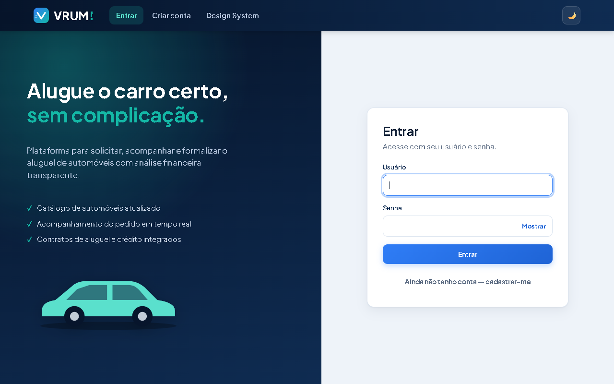</td>
  </tr>
</table>

---

## 🚧 Status do Projeto

 -brightgreen?style=for-the-badge)  

     
  

---

## 📚 Índice
- [Links Úteis](#-links-úteis)
- [Sobre o Projeto](#-sobre-o-projeto)
- [Funcionalidades Principais](#-funcionalidades-principais)
- [Tecnologias Utilizadas](#-tecnologias-utilizadas)
- [Arquitetura](#-arquitetura)
  - [Modelos UML e versões](#modelos-uml-e-versões)
- [Instalação e Execução](#-instalação-e-execução)
  - [Pré-requisitos](#pré-requisitos)
  - [Variáveis de Ambiente](#-variáveis-de-ambiente)
  - [Instalação de Dependências](#-instalação-de-dependências)
  - [Inicialização do Banco de Dados](#-inicialização-do-banco-de-dados-supabase)
  - [Como Executar a Aplicação](#-como-executar-a-aplicação)
- [Deploy](#-deploy)
- [Estrutura de Pastas](#-estrutura-de-pastas)
- [Demonstração](#-demonstração)
- [Testes](#-testes)
- [Documentações utilizadas](#-documentações-utilizadas)
- [Autores](#-autores)
- [Contribuição](#-contribuição)
- [Agradecimentos](#-agradecimentos)
- [Licença](#-licença)

---

## 🔗 Links Úteis
- 🌐 **Demo Online:** ainda não publicada. A aplicação roda localmente; veja [Como Executar](#-como-executar-a-aplicação) e [Deploy](#-deploy) (Vercel + Render).
- 📖 **Documentação:**
  - [Documentação da API REST](docs/API.md): rotas, perfis, códigos de resposta e exemplos de payload.
  - [Histórias de usuário](docs/historias-de-usuario.md) · [Diagramas UML](docs/diagramas/) · [Design System](docs/design-system.md)
  - [Roteiro de testes manuais](docs/testes-manuais.md) · [Limitações conhecidas](docs/limites-conhecidos.md)

---

## 📝 Sobre o Projeto
O VRUM! apoia a gestão de aluguéis de automóveis pela Internet. O sistema só pode ser usado após **cadastro e login** (usuário e senha).

- **Clientes** introduzem, modificam, consultam e cancelam pedidos de aluguel.
- **Agentes** (empresas e bancos) modificam e avaliam pedidos. Os pedidos passam por **análise financeira** e, com parecer positivo, seguem para a **execução do contrato**.
- Dos contratantes são armazenados RG, CPF, nome, endereço, profissão, entidades empregadoras e rendimentos (**máximo 3**).
- Dos automóveis: matrícula, ano, marca, modelo e placa. Conforme o tipo de contrato, o automóvel é registrado como propriedade do **cliente**, da **empresa** ou do **banco**.
- O aluguel pode ter um **contrato de crédito** concedido por um banco agente.

> [!NOTE]
> Conforme o enunciado, o sistema se divide em dois subsistemas: **gestão de pedidos e contratos** (back-end Spring Boot) e **construção dinâmica das páginas web** (front-end React + Vite).

---

## ✨ Funcionalidades Principais
- 🔐 **Autenticação** por usuário e senha (BCrypt) com sessão; permissões por perfil (cliente × agente), também no back-end.
- 🪪 **Cadastro por perfil:** na tela *Criar conta* a pessoa escolhe **Cliente** (CPF, rendimentos), **Empresa** (CNPJ, razão social) ou **Banco** (CNPJ, código do banco). CPF/CNPJ validados e login único entre todos os perfis. O autocadastro de empresas/bancos pode ser desligado em produção (`APP_CADASTRO_AGENTES_PUBLICO=false`).
- 👤 **CRUD de clientes** (agente), com validação de CPF, login/CPF duplicados e no máximo 3 rendimentos; o cliente consulta e altera os **próprios dados** em *Meus dados*.
- 🚘 **CRUD de automóveis** (matrícula, ano, marca, modelo, placa e proprietário).
- 📝 **Pedidos:** o cliente cria, consulta, altera e cancela; o agente altera, **inicia a análise financeira** (vendo profissão e renda do cliente) e aprova ou recusa (justificativa obrigatória). Linha do tempo do estado. Um automóvel não pode ter dois pedidos aprovados no mesmo período.
- 📄 **Contratos:** o pedido aprovado gera o contrato de aluguel (estado *executado*) e atualiza o proprietário do automóvel; o cliente consulta só os contratos dos próprios pedidos.
- 🏦 **Crédito opcional**, concedido somente por agente bancário.
- 🏠 **Início** por perfil, com indicadores reais.
- 🎨 **Design System** documentado dentro do app (aba *Design System*, acessível **sem login**): princípios, cores, tipografia, componentes vivos, estados, padrões e acessibilidade (contraste WCAG).
- 🌙 **Modo escuro:** segue o tema do sistema operacional e pode ser alternado pelo botão ☀️/🌙 no topo; a escolha fica salva no navegador. Todos os textos atingem contraste AA nos dois temas.
- 🧾 **Formulários com máscara e validação** (CPF, placa, datas), feedback de erro/sucesso e telas que se mantêm ao atualizar a página.

---

## 🛠 Tecnologias Utilizadas

### 💻 Front-end
- **Framework/Biblioteca:** React 18
- **Linguagem:** JavaScript (JSX)
- **Estilização:** CSS próprio com tokens (Design System), responsivo
- **Gerenciamento de Estado:** hooks do React (`useState`, `useEffect`, Context para toasts)
- **Build Tool:** Vite 5

### 🖥 Back-end
- **Linguagem/Runtime:** Java (JDK 25)
- **Framework:** Spring Boot 4.0.9 (Web MVC, Security, Data JPA, Validation)
- **Banco de Dados:** Supabase (PostgreSQL); H2 em memória apenas nos testes
- **ORM:** Hibernate / Spring Data JPA
- **Autenticação:** sessão HTTP (cookie) + BCrypt
- **Build:** Apache Maven (wrapper `mvnw`)

### ⚙ Infraestrutura & DevOps
- **Cloud:** Supabase (banco); opcionalmente Vercel (front) e Render (back)
- **Versionamento:** Git/GitHub · **Modelagem:** PlantUML

---

## 🏗 Arquitetura
O back-end segue **MVC em camadas**: `controller` → `service` → `repository` → `model` (entidades JPA), com `dto`, `config` (Security, CORS, BCrypt) e `exception` (tratamento centralizado com `ProblemDetail`). A **View** é o front-end React + Vite, que consome a API REST (JSON, sessão por cookie).

- **Fluxo de dados:** página React → `api.js` → controller → service (regras de negócio) → repository → Supabase.
- **Regras de negócio** ficam só nos services. Exemplos: máximo de 3 rendimentos, transições de estado do pedido, disponibilidade do automóvel, troca de proprietário no contrato, crédito somente pelo banco.
- **Erros** usam exceções do domínio (`RecursoNaoEncontrado` → 404, `RegraNegocio` → 400, `AcessoNegado` → 403).

| Diagrama de casos de uso | Diagrama de pacotes (visão lógica) |
|---|---|
|  |  |

O **diagrama de classes** tem três visões, todas alinhadas ao código:

| Visão | Conteúdo |
|---|---|
| [Pacote `model`](docs/diagramas/Diagrama_classes.png) | Entidades JPA, herança JOINED (`Usuario` → `Cliente`/`Agente` → `AgenteEmpresa`/`AgenteBanco`), associações e enums |
| [Controllers → Services → Repositories](docs/diagramas/Diagrama_classes_camadas.png) | Métodos de cada camada, dependências entre elas e configuração de segurança |
| [Pacotes `dto` e `exception`](docs/diagramas/Diagrama_classes_dto_exception.png) | Requests, responses, exceções do domínio e o `TratadorDeExcecoes` (`ProblemDetail`) |


### Modelos UML e versões
Fontes editáveis em `docs/diagramas/*.puml` (versão atual: **v2**). Todas as versões anteriores estão em [`docs/diagramas/versoes/`](docs/diagramas/versoes/):

| Versão | O que mudou |
|---|---|
| [v0](docs/diagramas/versoes/v0/) | Modelagem inicial (casos de uso, classes e pacotes) |
| [v1](docs/diagramas/versoes/v1/) | Casos de uso reorganizados, com análise financeira em duas etapas (iniciar → aprovar/recusar com justificativa), geração e consulta de contratos (cliente vê só os seus) e manutenção de automóveis; enum `StatusContrato` no diagrama de classes; camadas MVC e pacote `exception` no diagrama de pacotes |
| v2 (atual) | *Consultar/alterar meus dados* (cliente), *Consultar renda do cliente* (incluído na análise) e *Cadastrar-se como empresa/banco*; regra de disponibilidade do automóvel; diagrama de classes em **três visões** (model · controllers/services/repositories · dto/exception); os dois subsistemas do enunciado e a exceção `AcessoNegado` no diagrama de pacotes |

---

## 🔧 Instalação e Execução

### Pré-requisitos
- JDK 25 · Node.js 18+ e npm · Git · projeto no [Supabase](https://supabase.com)

### 🔑 Variáveis de Ambiente

#### 1 Back-end (Spring Boot)
Crie o arquivo **`backend/.env`** a partir de `backend/.env.example`. Ele é lido automaticamente pelo Spring (`spring.config.import`) e **é ignorado pelo Git**: nunca versione valores reais.

| Variável | Descrição |
|---|---|
| `SUPABASE_DB_URL` | `jdbc:postgresql://<HOST>:6543/postgres?sslmode=require&prepareThreshold=0` (Supabase → Connect → *Transaction pooler*) |
| `SUPABASE_DB_USER` | `postgres.<project-ref>` |
| `SUPABASE_DB_PASSWORD` | senha do banco |
| `APP_SETUP_TOKEN` | token aleatório para criar agentes via API quando o autocadastro estiver desligado |
| `APP_CADASTRO_AGENTES_PUBLICO` | `true` (padrão): a tela de cadastro permite Empresa e Banco · `false`: só clientes |
| `DB_POOL_SIZE` | conexões do pool (padrão `5`) |
| `APP_CORS_ORIGINS` | origens do front (padrão `http://localhost:5173`) |
| `SESSION_COOKIE_SAME_SITE` / `SESSION_COOKIE_SECURE` | `lax`/`false` local; `lax`/`true` em produção (o front chama a API pelo proxy da Vercel) |
| `PORT` | porta HTTP (padrão `8080`; o Render define automaticamente) |

> [!IMPORTANT]
> Use o **Transaction pooler (porta 6543)** com `prepareThreshold=0`. O *Session pooler* (5432) do plano gratuito aceita no máximo **15 conexões no total**; com o backend do Render e alguém rodando localmente, o limite estoura (`EMAXCONNSESSION`).

> [!TIP]
> Também é possível definir as variáveis no terminal (`$env:NOME="valor"` no PowerShell, `export NOME=valor` no Linux/macOS); elas têm prioridade sobre o `.env`.

#### 2 Front-end (React, Vite)
| Variável | Descrição |
|---|---|
| `VITE_API_URL` | Deixe **vazio** em desenvolvimento e na Vercel: o front chama `/api`, que o Vite (local) ou a Vercel (produção, `vercel.json`) repassam ao back-end. Só preencha se não usar o proxy. Nunca coloque segredos em variáveis `VITE_*`. |

### 📦 Instalação de Dependências
```bash
git clone https://github.com/pamelanilo/Sistema_Aluguel_Carros.git
cd Sistema_Aluguel_Carros
```

#### Front-end (React)
```bash
cd frontend && npm install
```

#### Back-end (Spring Boot)
```bash
cd backend && ./mvnw clean install      # Windows: .\mvnw.cmd clean install
```

### 💾 Inicialização do Banco de Dados (Supabase)
1. Crie um projeto no Supabase e anote a senha do banco.
2. Em **Connect → Transaction pooler**, copie host e usuário e preencha o `backend/.env` (porta 6543, com `prepareThreshold=0`).
3. As tabelas são criadas/atualizadas automaticamente na primeira execução (`spring.jpa.hibernate.ddl-auto=update`).

### ⚡ Como Executar a Aplicação

#### Terminal 1: Back-end (Spring Boot)
```bash
cd backend
./mvnw spring-boot:run      # Windows: .\mvnw.cmd spring-boot:run
```
API em `http://localhost:8080`.

#### Terminal 2: Front-end (React, Vite)
```bash
cd frontend
npm run dev
```
Acesse `http://localhost:5173`.

#### Criar contas
Na tela **Criar conta**, escolha **Cliente**, **Empresa** ou **Banco**. Se o autocadastro de agentes estiver desligado (`APP_CADASTRO_AGENTES_PUBLICO=false`), empresas e bancos só podem ser criados por um agente logado ou com o token de instalação (`APP_SETUP_TOKEN`):
```bash
curl -X POST http://localhost:8080/agentes/empresas -H "Content-Type: application/json" -H "X-Setup-Token: <APP_SETUP_TOKEN>" \
  -d '{"nome":"Agente Empresa","login":"agente1","senha":"senha123","cnpj":"12345678000195","razaoSocial":"VRUM Locadora"}'
curl -X POST http://localhost:8080/agentes/bancos -H "Content-Type: application/json" -H "X-Setup-Token: <APP_SETUP_TOKEN>" \
  -d '{"nome":"Agente Banco","login":"banco1","senha":"senha123","cnpj":"98765432000198","codigoBanco":"341"}'
```

#### 🔓 Como acessar o sistema
| O quê | Endereço |
|---|---|
| Aplicação (front-end) | http://localhost:5173 |
| API (back-end) | http://localhost:8080 |

**Contas de demonstração** já cadastradas no banco do projeto (senha `senha123` para todas):

| Perfil | Login |
|---|---|
| Agente da empresa | `agente1` |
| Agente do banco | `banco1` |
| Cliente | `cliente1` (Ana Souza) · `cliente2` (Bruno Alves) |

Novas contas: *Criar conta* no topo (ou *Ainda não tenho conta* na tela de login).

#### Fluxo de uso
| Perfil | Fluxo |
|---|---|
| Cliente | Cadastrar-se → Entrar → Catálogo → Solicitar aluguel → Meus pedidos → Contratos · Meus dados |
| Agente | Análise de pedidos → Iniciar análise → Aprovar/Recusar → Gerar contrato → Contratos |
| Agente banco | Idem, além de contrato de propriedade do banco e concessão de crédito |

---

## 🚀 Deploy
O back-end vai para o **Render** (container Docker) e o front-end para a **Vercel**. Os arquivos já estão no repositório:

| Arquivo | Função |
|---|---|
| [`backend/Dockerfile`](backend/Dockerfile) | Build em duas etapas: JDK 25 + Maven Wrapper compilam; a imagem final só tem o JRE 25, roda com usuário sem privilégios e limita a heap a 75% da memória |
| [`backend/.dockerignore`](backend/.dockerignore) | Impede que `.env` e `target/` entrem na imagem |
| [`render.yaml`](render.yaml) | Blueprint do Render: serviço Docker, região Virgínia (mesma do Supabase), health check `/health` e variáveis |
| [`frontend/vercel.json`](frontend/vercel.json) | Build do Vite e **rewrite** de `/api/*` para o back-end no Render |

> [!NOTE]
> **Por que o rewrite?** Com front e back em domínios diferentes, o cookie de sessão seria de *terceiros*, e o Chrome/Safari o bloqueiam. Pela Vercel, o navegador vê um só site e o cookie continua funcionando (`SameSite=Lax; Secure`).

### 1. Back-end no Render
1. Dashboard do Render → **New → Blueprint** → conecte este repositório (o `render.yaml` é detectado).
2. Preencha as variáveis pedidas: `SUPABASE_DB_URL` (Transaction pooler, porta 6543, `prepareThreshold=0`), `SUPABASE_DB_USER`, `SUPABASE_DB_PASSWORD` e `APP_CORS_ORIGINS` (URL da Vercel; pode ajustar depois). `APP_SETUP_TOKEN` é gerado automaticamente.
3. Aguarde o build e confira `https://<seu-servico>.onrender.com/health` → `{"status":"UP"}`.

> Sem Blueprint: **New → Web Service** → *Docker*, **Root Directory** `backend`, Health Check Path `/health` e as mesmas variáveis.

### 2. Front-end na Vercel
1. Se o nome do serviço no Render **não** for `vrum-backend`, troque a URL em `frontend/vercel.json` (`destination`) pela URL real e faça commit.
2. Vercel → **Add New → Project** → importe o repositório → **Root Directory:** `frontend` (o framework Vite é detectado). Não é preciso definir `VITE_API_URL`.
3. Depois do deploy, coloque a URL da Vercel em `APP_CORS_ORIGINS` no Render.

> [!WARNING]
> No plano gratuito o Render "dorme" após 15 min sem uso; a primeira requisição depois disso leva ~1 min. Em produção, considere `APP_CADASTRO_AGENTES_PUBLICO=false` para que ninguém se cadastre como banco/empresa sem autorização.

### Build manual (sem Docker)
```bash
cd frontend && npm run build        # gera frontend/dist
cd backend && ./mvnw clean package  # gera backend/target/backend-0.0.1-SNAPSHOT.jar
java -jar backend/target/backend-0.0.1-SNAPSHOT.jar
```

---

## 📂 Estrutura de Pastas
```text
Sistema_Aluguel_Carros/
├── backend/
│   ├── .env.example                 # modelo de variáveis (o .env real não é versionado)
│   ├── Dockerfile · .dockerignore   # imagem para o Render
│   ├── pom.xml
│   └── src/
│       ├── main/java/br/com/aluguelcarros/backend/
│       │   ├── config/              # Security, CORS, BCrypt
│       │   ├── controller/          # Controllers REST (Auth, Cliente, Automovel, Pedido, Contrato, Agente)
│       │   ├── dto/                 # Requests/Responses
│       │   ├── exception/           # Exceções de domínio + TratadorDeExcecoes
│       │   ├── model/               # Entidades JPA (+ enums)
│       │   ├── repository/          # Spring Data JPA
│       │   └── service/             # Regras de negócio
│       ├── main/resources/application.properties
│       ├── test/java/...            # unitários, integração (H2) e contexto
│       └── test/resources/application-it.properties
├── frontend/
│   ├── index.html · vite.config.js · vercel.json · package.json
│   └── src/
│       ├── pages/                   # Login, Cadastro, Inicio, Catalogo, Pedidos, Contratos,
│       │                            # MeusDados, GestaoCarros, GestaoClientes, DesignSystem
│       ├── App.jsx                  # roteamento por perfil
│       ├── api.js                   # cliente HTTP
│       ├── ui.jsx · utils.js        # componentes e máscaras
│       └── style.css                # tokens e estilos (Design System)
├── render.yaml                      # blueprint do Render
├── docs/
│   ├── diagramas/                   # .puml + .png (v2: casos de uso, pacotes, classes em 3 visões) e versoes/
│   ├── screenshots/                 # imagens da demonstração
│   ├── API.md · design-system.md · historias-de-usuario.md
│   └── testes-manuais.md · limites-conhecidos.md
└── README.md
```

---

## 🎥 Demonstração

### 🌐 Aplicação Web

| Login | Criar conta (cliente, empresa ou banco) |
|---|---|
|  | 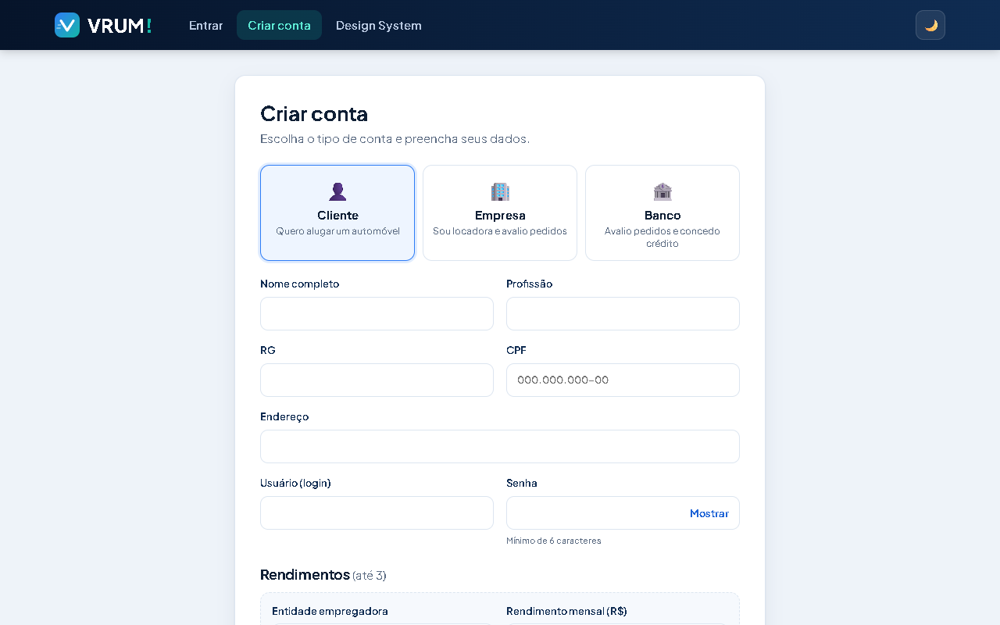 |
| **Início (cliente)** | **Catálogo de automóveis** |
| 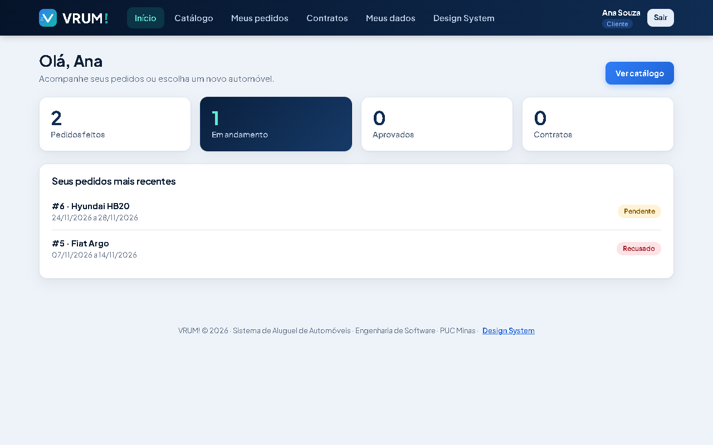 | 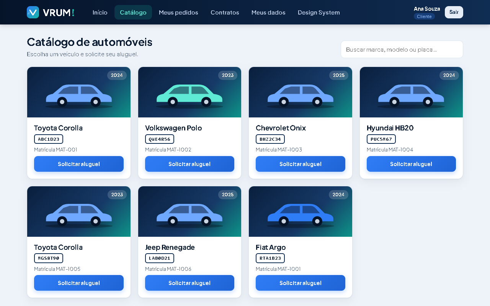 |
| **Meus pedidos (com recusa justificada)** | **Meus dados** |
| 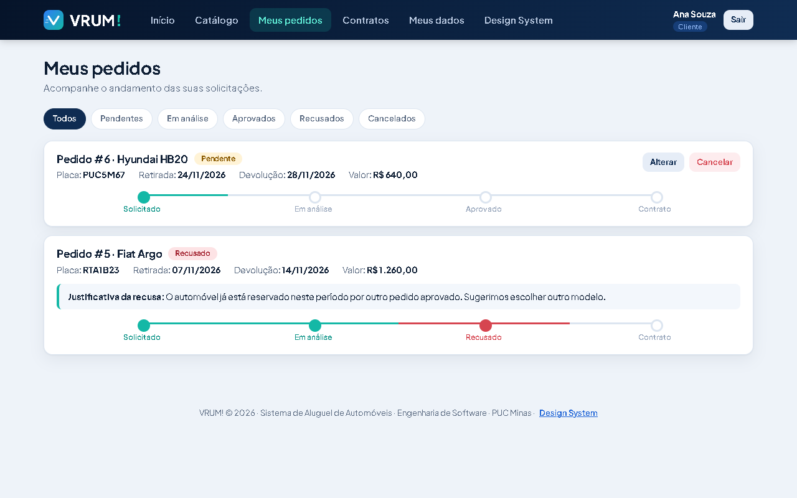 | 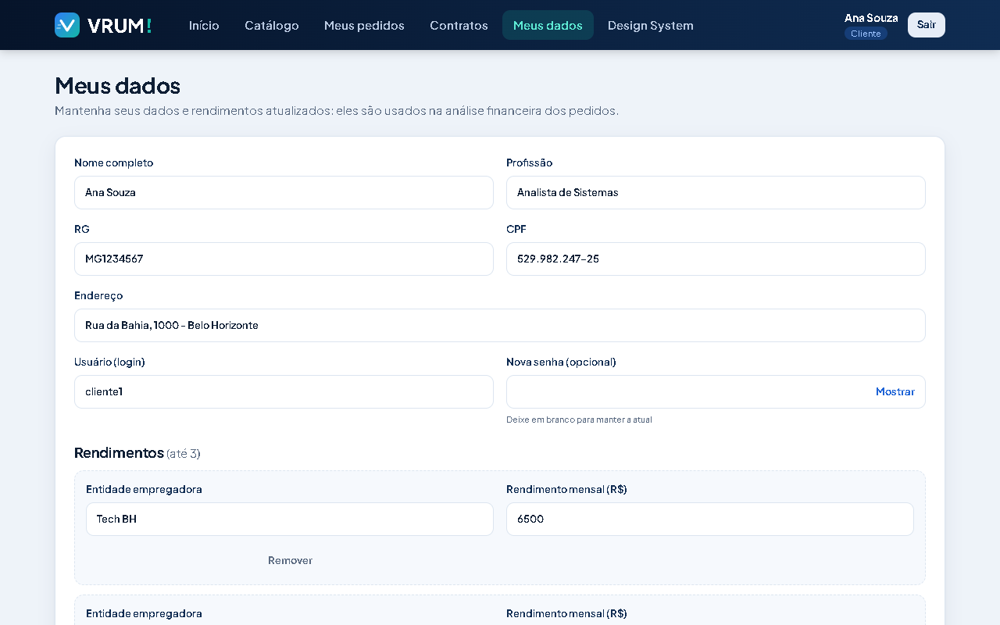 |
| **Análise financeira (agente)** | **Contratos de aluguel e crédito** |
| 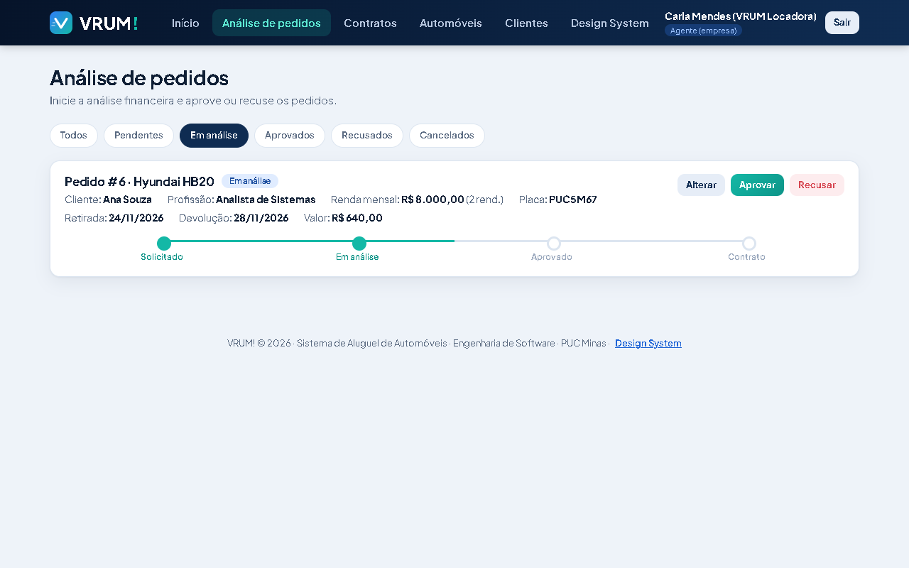 | 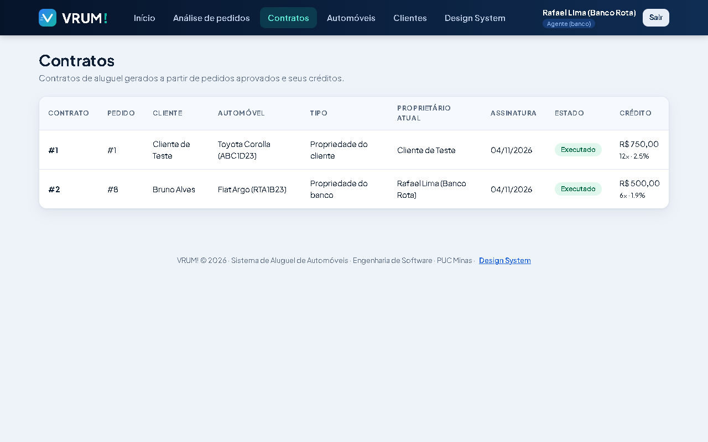 |
| **Gestão de automóveis** | **Gestão de clientes** |
| 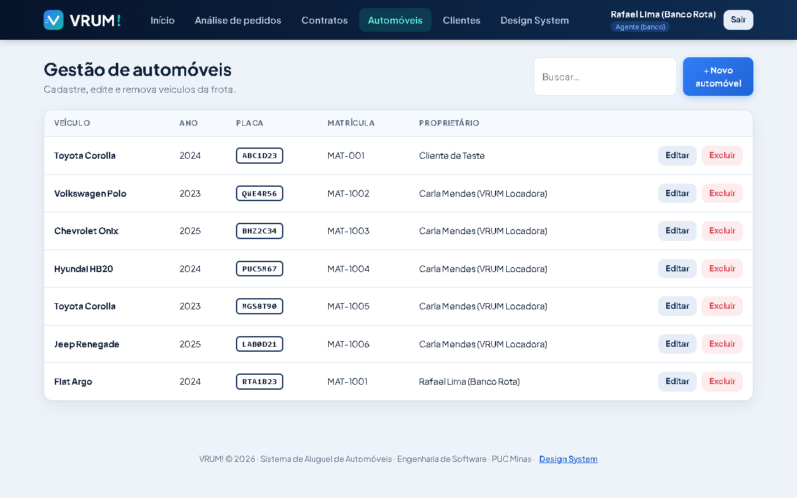 | 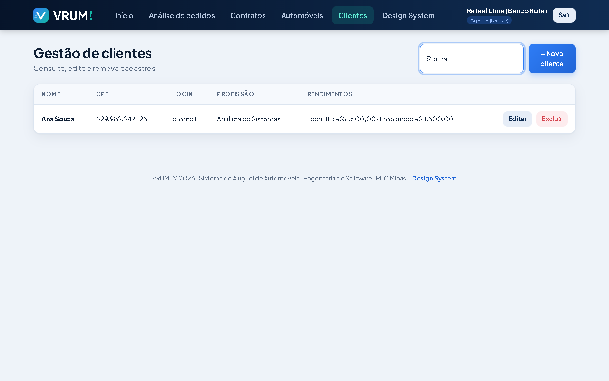 |
| **Design System (sem login)** | **Modo escuro** |
| 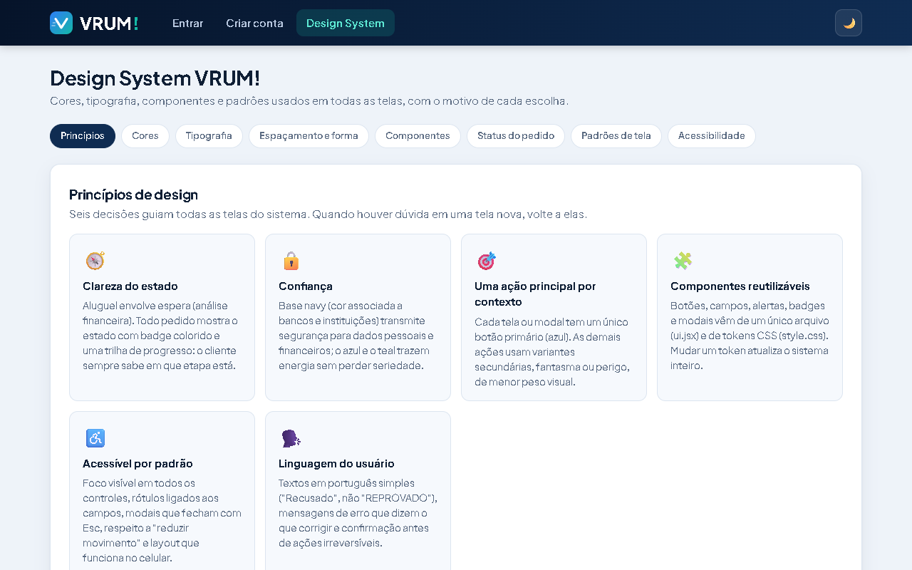 | 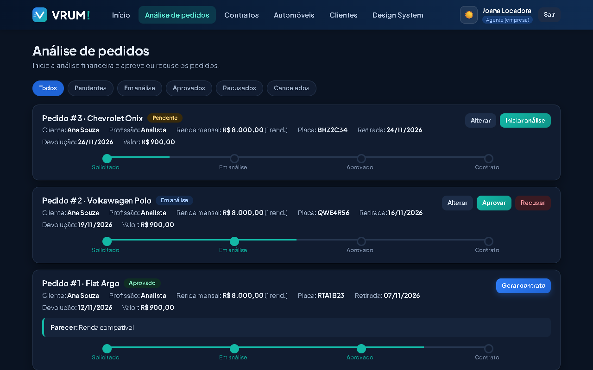 |

### 💻 Exemplo de Saída no Terminal

#### 1. Demonstração da API (cURL)
```bash
curl -c cookies.txt -H "Content-Type: application/json" -d '{"login":"cliente1","senha":"senha123"}' http://localhost:8080/auth/login
curl -b cookies.txt http://localhost:8080/pedidos
```
Saída esperada (resumida):
```json
[{"id":6,"status":"EM_ANALISE","marca":"Hyundai","modelo":"HB20","placa":"PUC5M67",
  "dataInicio":"2026-11-24","dataFim":"2026-11-28","valorTotal":640.00,
  "clienteNome":"Ana Souza","clienteProfissao":"Analista de Sistemas","clienteRendaTotal":8000.00}]
```

#### 2. Execução dos testes
```text
[INFO] Tests run: 2, Failures: 0, Errors: 0, Skipped: 0 -- in ...FluxoAluguelIntegrationTest
[INFO] Tests run: 8, Failures: 0, Errors: 0, Skipped: 1
[INFO] BUILD SUCCESS
```

---

## 🧪 Testes

### Testes Unitários e de Integração
```bash
cd backend && ./mvnw test        # Windows: .\mvnw.cmd test
```
- **Unitários** (modelo e DTO): não precisam de banco.
- **Integração** (`FluxoAluguelIntegrationTest`): sobe a aplicação com **H2 em memória** (perfil `it`, dependência só de teste) e percorre o fluxo inteiro pela API: cadastro, login, pedido, análise, aprovação, disponibilidade, contrato (troca de proprietário), crédito e permissões.
- **Cadastro restrito** (`CadastroAgentesRestritoTest`): com `APP_CADASTRO_AGENTES_PUBLICO=false`, empresa/banco só com o token.
- **Contexto com Supabase** (`BackendApplicationTests`): só roda quando `SUPABASE_DB_URL` está definida no ambiente.

### Testes End-to-End (E2E)
Roteiro manual com 35 casos em [`docs/testes-manuais.md`](docs/testes-manuais.md), executado na aplicação conectada ao Supabase. Verificação de compilação do front: `cd frontend && npm run build`.

---

## 🔗 Documentações utilizadas
- **Framework/Biblioteca (Front-end):** [Documentação Oficial do React](https://react.dev/reference/react)
- **Build Tool (Front-end):** [Guia de Configuração do Vite](https://vitejs.dev/config/)
- **Framework (Back-end):** [Documentação Oficial do Spring Boot](https://docs.spring.io/spring-boot/index.html)
- **Banco de Dados:** [Documentação do Supabase](https://supabase.com/docs)
- **Modelagem:** [PlantUML](https://plantuml.com)
- **Guia de Estilo:** [Conventional Commits](https://www.conventionalcommits.org/en/v1.0.0/)
- **Documentação Interna:** [Design System do Projeto](docs/design-system.md)

---

## 👥 Autores
| 👤 Nome | :octocat: GitHub | 💼 LinkedIn | 📤 Gmail |
|---|---|---|---|
| Pamela Fernandes Nilo | [@pamelanilo](https://github.com/pamelanilo) | _adicione seu LinkedIn_ | [pamelanilo12@gmail.com](mailto:pamelanilo12@gmail.com) |

---

## 🤝 Contribuição
1. Faça um fork do projeto.
2. Crie uma branch: `git checkout -b feature/minha-feature`.
3. Commite seguindo o [Conventional Commits](https://www.conventionalcommits.org/en/v1.0.0/): `git commit -m 'feat: Adiciona nova funcionalidade X'`.
4. Envie: `git push origin feature/minha-feature`.
5. Abra um Pull Request.

---

## 🙏 Agradecimentos
- [Engenharia de Software PUC Minas](https://www.instagram.com/engsoftwarepucminas/), pelo apoio institucional e pela estrutura acadêmica.
- [Prof. Dr. João Paulo Aramuni](https://github.com/joaopauloaramuni), pela orientação na disciplina de Desenvolvimento e Integração de Aplicações Web.

---

## 📄 Licença
Projeto acadêmico desenvolvido para a disciplina DIAW da PUC Minas, sem licença de distribuição definida.
