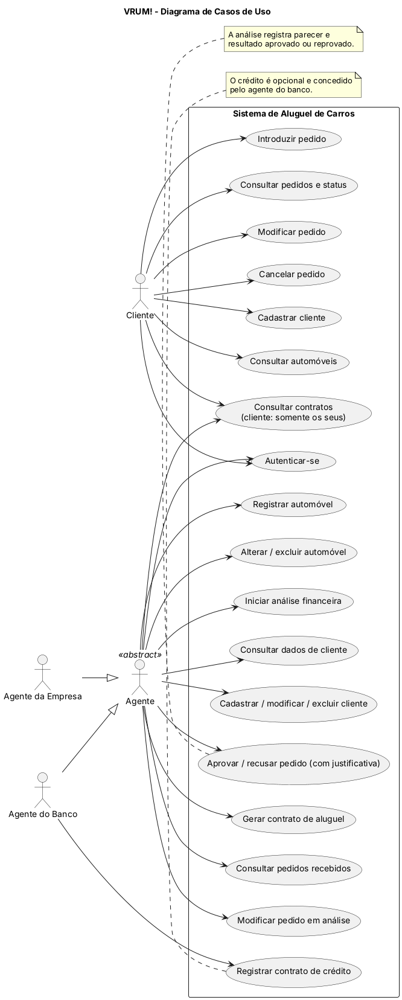
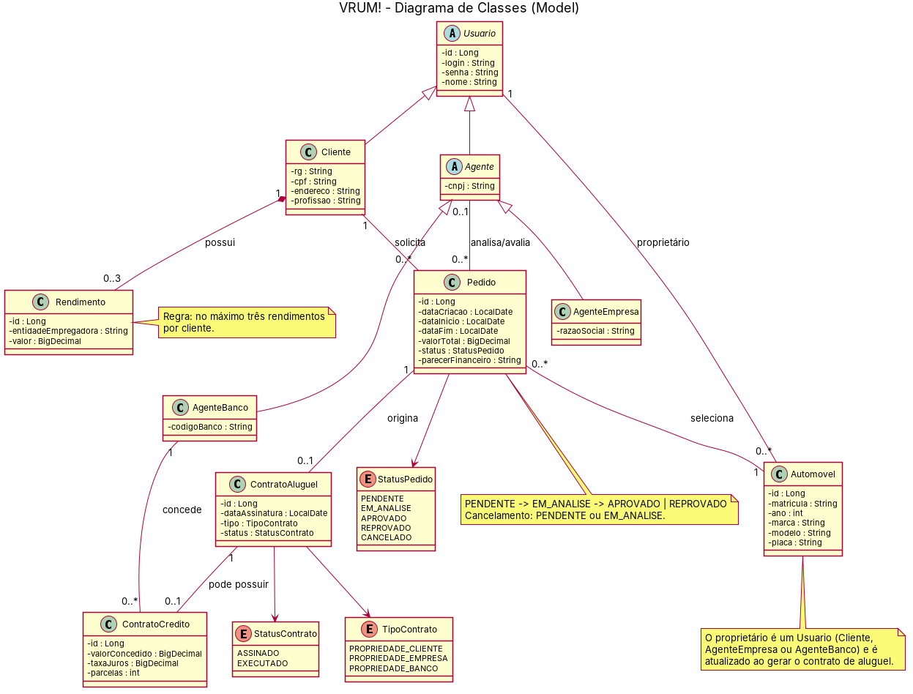
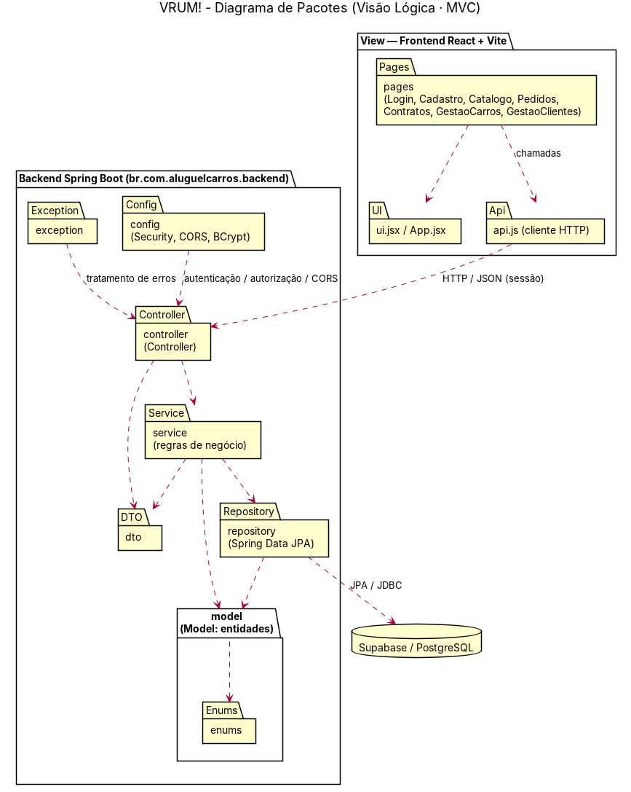

# 🚗 VRUM! — Sistema de Aluguel de Automóveis

> [!NOTE]
> Plataforma web para solicitar, acompanhar, analisar e formalizar aluguéis de automóveis, com perfis de **cliente**, **agente da empresa** e **agente do banco**.

**Laboratório 02 — DIAW · Engenharia de Software · PUC Minas · Prof. João Paulo Carneiro Aramuni**

---

## 🚧 Status do Projeto

      

---

## 📚 Índice
- [Links Úteis](#-links-úteis)
- [Sobre o Projeto](#-sobre-o-projeto)
- [Funcionalidades Principais](#-funcionalidades-principais)
- [Tecnologias Utilizadas](#-tecnologias-utilizadas)
- [Arquitetura](#-arquitetura)
- [Instalação e Execução](#-instalação-e-execução)
- [Deploy](#-deploy)
- [Estrutura de Pastas](#-estrutura-de-pastas)
- [Demonstração](#-demonstração)
- [Testes](#-testes)
- [Documentações utilizadas](#-documentações-utilizadas)
- [Autores](#-autores)
- [Contribuição](#-contribuição)
- [Licença](#-licença)

---

## 🔗 Links Úteis
- [Histórias de usuário](docs/historias-de-usuario.md)
- [Documentação da API](docs/API.md)
- [Roteiro de testes manuais](docs/testes-manuais.md)
- [Limitações conhecidas](docs/limites-conhecidos.md)
- [Diagramas UML](docs/diagramas/) (`.puml` editáveis e `.png`)

---

## 📝 Sobre o Projeto
O VRUM! apoia a gestão de aluguéis de automóveis pela Internet. O sistema só é utilizado após **cadastro e login**. Clientes introduzem, modificam, consultam e cancelam pedidos; agentes (empresas e bancos) modificam e avaliam pedidos. Os pedidos passam por **análise financeira** e, em caso de parecer positivo, seguem para a **execução do contrato**, que pode ter um **contrato de crédito** concedido por um banco agente.

São armazenados, para os contratantes, RG, CPF, nome, endereço, profissão, entidades empregadoras e rendimentos (**máximo 3**). Dependendo do tipo de contrato, o automóvel é registrado como propriedade do cliente, da empresa ou do banco.

---

## ✨ Funcionalidades Principais
- 🔐 **Autenticação** por usuário e senha (BCrypt) com sessão; permissões por perfil.
- 👤 **CRUD de clientes** com validação de CPF e de login/CPF duplicados.
- 🚘 **CRUD de automóveis** (matrícula, ano, marca, modelo, placa e proprietário).
- 📝 **Pedidos:** cliente cria, consulta, altera e cancela; agente altera, **inicia a análise financeira**, aprova ou recusa (justificativa obrigatória); linha do tempo do estado.
- 📄 **Contratos:** pedido aprovado gera contrato de aluguel (estado *executado*) e atualiza o proprietário do automóvel; o cliente consulta (somente leitura) os contratos dos próprios pedidos.
- 🏠 **Tela de Início** por perfil, com indicadores reais (pedidos em andamento, aguardando análise, contratos, frota).
- 🧾 **Formulários com máscara e validação** (CPF, placa, datas), feedback de erro/sucesso e navegação que preserva a tela ao atualizar a página.
- 🏦 **Crédito opcional**, concedido somente por agente bancário.

---

## 🛠 Tecnologias Utilizadas

### 💻 Front-end
- React 18 + Vite 5, CSS próprio responsivo

### 🖥️ Back-end
- Java (JDK 25), Spring Boot 4.0.x (Web MVC, Security, Data JPA, Validation), Apache Maven

### ⚙️ Infraestrutura
- Supabase (PostgreSQL) · Git/GitHub · (opcional) Vercel e Render

---

## 🏗 Arquitetura
O back-end segue **MVC em camadas**: `controller` → `service` → `repository` → `model` (entidades JPA), com `dto`, `config` e `exception`. A **View** é o front-end React + Vite, que consome a API REST (JSON, sessão por cookie).

| Diagrama de casos de uso | Diagrama de classes | Diagrama de pacotes |
|---|---|---|
|  |  |  |

Fontes editáveis: `docs/diagramas/*.puml`.

---

## 🔧 Instalação e Execução

### Pré-requisitos
- JDK 25 · Node.js 18+ e npm · Git · conta gratuita no [Supabase](https://supabase.com)

### 🔑 Variáveis de Ambiente

#### 1 Back-end (Spring Boot)
Modelo em `backend/.env.example` (**não versione valores reais**):

| Variável | Descrição |
|---|---|
| `SUPABASE_DB_URL` | `jdbc:postgresql://<HOST>:5432/postgres?sslmode=require` |
| `SUPABASE_DB_USER` | `postgres.<project-ref>` |
| `SUPABASE_DB_PASSWORD` | senha do banco |
| `APP_SETUP_TOKEN` | token aleatório para criar o primeiro agente |
| `APP_CORS_ORIGINS` | origens do front (padrão `http://localhost:5173`) |
| `SESSION_COOKIE_SAME_SITE` / `SESSION_COOKIE_SECURE` | `lax`/`false` local; `none`/`true` em produção HTTPS |

PowerShell:
```powershell
$env:SUPABASE_DB_URL="jdbc:postgresql://<HOST>:5432/postgres?sslmode=require"
$env:SUPABASE_DB_USER="postgres.<project-ref>"
$env:SUPABASE_DB_PASSWORD="<senha>"
$env:APP_SETUP_TOKEN="<token-aleatorio>"
```
Linux/macOS: use `export NOME=valor`.

#### 2 Front-end (React, Vite)
`frontend/.env.example`: `VITE_API_URL` — deixe **vazio** em desenvolvimento (o Vite faz proxy de `/api` para `localhost:8080`). Em produção, informe a URL pública do back-end. Nunca coloque segredos em variáveis `VITE_*`.

### 📦 Instalação de Dependências
```bash
cd frontend && npm install        # front-end
cd backend && ./mvnw dependency:resolve   # back-end (Windows: .\mvnw.cmd ...)
```

### 💾 Inicialização do Banco de Dados (Supabase)
1. Crie um projeto no Supabase e anote a senha do banco.
2. Em **Connect**, copie host, porta e usuário do *Session pooler* (ou conexão direta) e monte a URL JDBC acima.
3. As tabelas são criadas automaticamente na primeira execução (`spring.jpa.hibernate.ddl-auto=update`).

### ⚡ Como Executar a Aplicação
> Defina as variáveis de ambiente do back-end **no mesmo terminal** em que vai executar o Maven (veja a seção anterior).

#### Terminal 1: Back-end
```bash
cd backend
./mvnw spring-boot:run      # Windows: .\mvnw.cmd spring-boot:run
```
API em `http://localhost:8080`.

#### Terminal 2: Front-end
```bash
cd frontend
npm run dev
```
Acesse `http://localhost:5173`.

#### Criar os agentes (primeiro acesso)
Agentes não se cadastram pela tela. Crie-os com o token de instalação:
```bash
curl -X POST http://localhost:8080/agentes/empresas -H "Content-Type: application/json" -H "X-Setup-Token: $APP_SETUP_TOKEN" \
  -d '{"nome":"Agente Empresa","login":"agente1","senha":"senha123","cnpj":"00000000000191","razaoSocial":"VRUM Locadora"}'
curl -X POST http://localhost:8080/agentes/bancos -H "Content-Type: application/json" -H "X-Setup-Token: $APP_SETUP_TOKEN" \
  -d '{"nome":"Agente Banco","login":"banco1","senha":"senha123","cnpj":"00000000000272","codigoBanco":"001"}'
```
Entre como agente, cadastre automóveis (proprietário: a empresa) e crie um cliente pela tela **Cadastro**.

#### 🔓 Como acessar o sistema
| O quê | Endereço |
|---|---|
| Aplicação (front-end) | http://localhost:5173 |
| API (back-end) | http://localhost:8080 |

- **Cliente:** clique em *Ainda não tenho conta* na tela de login, preencha o cadastro e entre com o usuário e a senha criados.
- **Agentes (empresa e banco):** criados pelos comandos acima; entre com o `login` e a `senha` informados neles.

#### Fluxo de uso
| Perfil | Fluxo |
|---|---|
| Cliente | Cadastrar-se → Entrar → Catálogo → Solicitar aluguel → Meus pedidos |
| Agente | Análise de pedidos → Iniciar análise → Aprovar/Recusar → Gerar contrato → Contratos |
| Agente banco | Idem, além de conceder crédito em Contratos |

---

## 🚀 Deploy
```bash
cd frontend && npm run build        # gera frontend/dist
cd backend && ./mvnw clean package  # gera backend/target/*.jar
java -jar backend/target/*.jar
```
Front-end na Vercel (`VITE_API_URL` = URL do back-end) e back-end no Render com as variáveis acima, `SESSION_COOKIE_SAME_SITE=none`, `SESSION_COOKIE_SECURE=true` e `APP_CORS_ORIGINS` com o domínio do front.

---

## 📂 Estrutura de Pastas
```text
Sistema_Aluguel_Carros/
├── backend/
│   ├── src/main/java/br/com/aluguelcarros/backend/
│   │   ├── config/        # Security, CORS, BCrypt
│   │   ├── controller/    # Controllers REST
│   │   ├── dto/           # Requests/Responses
│   │   ├── exception/     # Tratamento de erros
│   │   ├── model/         # Entidades JPA (+ enums)
│   │   ├── repository/    # Spring Data JPA
│   │   └── service/       # Regras de negócio
│   ├── src/main/resources/application.properties
│   ├── src/test/java/...  # testes unitários (sem banco) e teste de contexto
│   └── pom.xml
├── frontend/
│   └── src/ (pages/, App.jsx, api.js, ui.jsx, utils.js, style.css)
├── docs/                  # API, histórias, testes, diagramas
└── README.md
```

---

## 🎥 Demonstração
Telas: **Login · Cadastro · Início · Catálogo · Solicitação de aluguel · Meus pedidos (com linha do tempo) · Análise de pedidos · Contratos · Gestão de automóveis · Gestão de clientes.**

Exemplo de chamada à API (após login, com cookie de sessão):
```bash
curl -b cookies.txt http://localhost:8080/pedidos
```

---

## 🧪 Testes
```bash
cd backend && ./mvnw test        # Windows: .\mvnw.cmd test
cd frontend && npm run build     # verificação de compilação do front
```
Os testes unitários do back-end (modelo e DTO) **não precisam de banco**. O teste de contexto (`BackendApplicationTests`) só é executado quando `SUPABASE_DB_URL` está definida; sem ela, é ignorado.

Roteiro manual completo em [`docs/testes-manuais.md`](docs/testes-manuais.md).

---

## 🔗 Documentações utilizadas
[Spring Boot](https://spring.io/projects/spring-boot) · [React](https://react.dev) · [Vite](https://vite.dev) · [Supabase](https://supabase.com/docs) · [PlantUML](https://plantuml.com)

---

## 👥 Autores
- **Pamela** — Engenharia de Software, PUC Minas _(acrescente seu sobrenome e matrícula antes da entrega)_.

## 🤝 Contribuição
Faça um fork, crie uma branch (`git checkout -b feature/minha-feature`), commite e abra um Pull Request.

## 📄 Licença
Projeto acadêmico, sem licença de distribuição definida.
