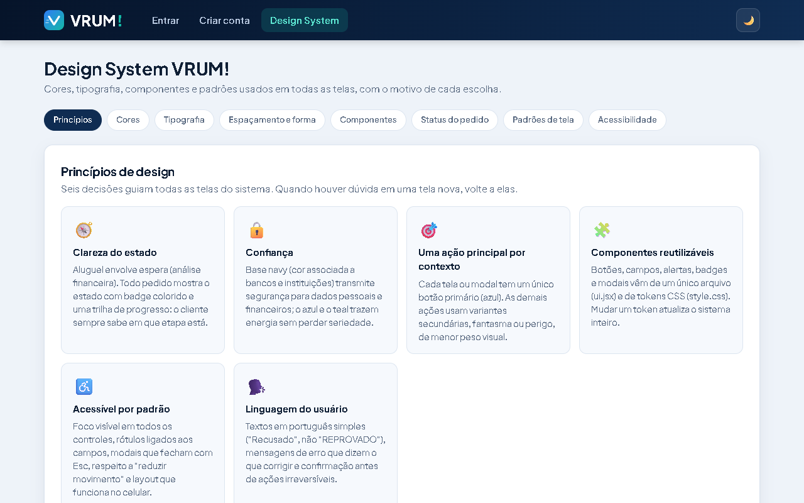

# Design System — VRUM!

A documentação completa e **interativa** está na própria aplicação: aba **Design System** no menu do topo, disponível **também sem login**. Os exemplos da tela usam os mesmos componentes das telas reais.

## Onde está no código
| Arquivo | Conteúdo |
|---|---|
| `frontend/src/style.css` | Tokens (`:root`: cores, raio `--r`, sombra `--sh`) e classes de componentes |
| `frontend/src/ui.jsx` | Componentes: `Botao`, `Campo`, `CampoSenha`, `Alerta`, `Badge`, `Modal`, `Spinner`, `Vazio`, `useToast`, `Logo`, `CarroArte` |
| `frontend/src/utils.js` | Máscaras de CPF/placa e validação de CPF |
| `frontend/src/pages/DesignSystem.jsx` | Tela de documentação |

## Resumo
- **Princípios:** clareza do estado do pedido, confiança, uma ação principal por contexto, componentes reutilizáveis, acessibilidade por padrão, linguagem do usuário.
- **Cores:** base navy (`--navy-950…700`), ação azul (`--blue`, `--blue-d`), acento teal (`--teal`, `--teal-d`), neutros (`--bg`, `--card`, `--txt`, `--mut`, `--line`) e feedback (`--ok`, `--warn`, `--bad`).
- **Tipografia:** Plus Jakarta Sans; escala 42 / 34 / 28 / 18 / 15 / 14 / 13 / 12 px; monoespaçada para placas.
- **Forma:** raios 6 → 18px (maior superfície, maior raio); uma sombra padrão para cartões.
- **Estados do pedido:** Pendente (amarelo), Em análise (azul), Aprovado/Executado (verde), Recusado (vermelho), Cancelado (cinza), sempre com texto.
- **Modo escuro:** cada token tem valor claro e escuro (`:root` × `[data-theme="dark"]` / `prefers-color-scheme`). O botão ☀️/🌙 no topo alterna e salva a escolha no navegador. Contrastes do tema escuro: todos AA ou melhor.
- **Acessibilidade:** foco visível, rótulos reais, `role="dialog"`/`role="alert"`, `prefers-reduced-motion`. Contrastes WCAG calculados na aba *Acessibilidade*; pontos abaixo de AA no tema claro: texto branco nos botões primário (3,9:1) e teal (2,5:1).
